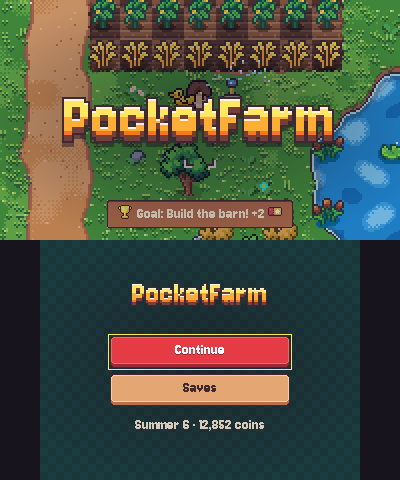
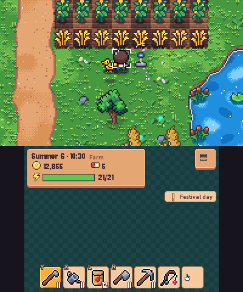
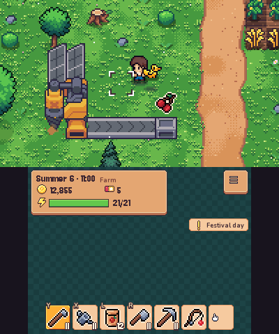
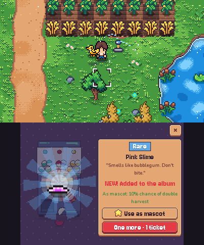

# PocketFarm 3DS

A cozy pocket farm for the **New Nintendo 3DS**. Grow crops through the seasons, raise animals, fish the pond
and the river, mine ore, make friends in town, collect critters from the capsule machine, and slowly turn your
farm into a small factory: conveyor belts, robotic arms, solar power, drones and full bread, wine and cheese lines.

 
 

## The game

**Farming.** Till, plant, water and harvest 8 crops (radish, carrot, cabbage, wheat, tomato, corn, beet,
pumpkin). Each season has its own crops, and a year has 4 seasons. Every action costs energy; sleep (or eat)
to get it back.

**The world.** Your farm, your house, Pocket Town (inn, forge, carpentry, market, fish shop), the forest with
its river, and the mine. Seven villagers live in town; talk to them and help with the town projects.

**Animals.** Build a coop and a barn for chickens, cows and sheep. Pet and feed them for eggs, milk and wool.
Later a "granja" (factory farm) doubles the animals, but they stop going outside and their mood drops.

**Fishing.** Buy a rod at the fish shop, cast into water and press A when the fish bites. The river has rarer
fish than the pond, and sometimes brings up clay on the hook.

**Mining.** Break stones with the pickaxe for stone, clay, coal and copper, iron and gold ore; smelt bars in a
furnace. Bars and clay build machines and cooking stations.

**Cooking.** Mill wheat into flour, mix and knead dough, bake bread. Press grapes into must, bottle it and age
it into wine in a cellar. Curdle milk into cheese. Every step works by hand first, then gets its own machine.

**Factories.** 34 pieces in total: belts, splitters, underground belts, arms, furnaces, processors, miners,
solar panels, steam boilers, power poles, silos, cold rooms, sorters, drones, auto-sell boxes and more. Build a
line, watch items flow, and let it sell for you.

**Mike's Workshop.** 9 factory puzzles with free pieces and up to 3 stars each, plus a **Daily Challenge**
that is the same for everyone each day. Place, rotate, move and remove pieces, then press Run. Share your score
as a code and see whether a friend can beat it. Items can be traded and gifted with codes too.

**Critters and the album.** 40 collectible critters come out of the capsule machine.
They walk around your farm and fill the album.

**Quests and festivals.** 24 quests guide you from your first carrot to a fully automated farm. Four seasonal
festivals: Flower Festival, Lake Luau, Harvest Festival and Winter Fair.

**Your house.** Upgrade it, decorate it with 48 pieces of furniture, and rest for bonuses.

## Requirements

- A **New** Nintendo 3DS, New 3DS XL or New 2DS XL. The original 3DS/2DS doesn't have enough memory.
- Custom firmware (Luma3DS) with the Homebrew Launcher or FBI. See [3ds.hacks.guide](https://3ds.hacks.guide).
- For sound: a DSP dump at `sdmc:/3ds/dspfirm.cdc`. Run the **DSP1** homebrew once to create it. Without it
  the game runs silently and says so on screen.

## Install

Download a file from the [latest release](../../releases/latest).

**Scan and install (FBI).** Open **FBI → Remote Install → Scan QR Code** and point the camera at this
code. It always installs the latest release.


**CIA (HOME menu icon).**

1. Copy `PocketFarm.cia` to the SD card (for example `sdmc:/cias/`).
2. Open **FBI**, choose *SD → cias → PocketFarm.cia → Install CIA*.
3. Start PocketFarm from the HOME menu.

**3DSX (Homebrew Launcher).**

1. Copy `PocketFarm.3dsx` to `sdmc:/3ds/`.
2. Open the Homebrew Launcher and start PocketFarm.

**Over Wi-Fi.** Start an FTP server on the 3DS (ftpd), then upload the file from your computer, for example
`curl -T PocketFarm.3dsx ftp://<3ds-ip>:5000/3ds/`.

**Updating.** Replace the `.3dsx`, or install the new `.cia` over the old one. Your saves are kept.

## Controls

| Button | Action |
| --- | --- |
| Circle Pad / D-Pad | walk |
| A | use the tool, talk, open, interact |
| B | open the menu, or go back |
| Y / X / L / R | tools 1–4 of the hotbar |
| Touch screen | HUD, hotbar, menus, shops, the workshop grid |
| START + SELECT | quit |

The top screen shows the world, and the bottom screen shows the HUD and menus. Tools act on the tile in front
of you. The tile cursor shows which one.

**In the workshop:** D-Pad moves the cursor, A places/rotates/moves, L/R change the piece, X runs or stops the
line, Y changes the speed and B goes back.

## Getting started

1. Follow the first quests in the Journal (menu → Journal): till, plant and water your first carrots.
2. Sell crops in the auto-sell box or the market, and buy seeds that fit the season.
3. Chop trees for wood, then visit the mine with the pickaxe for stone, ore and clay.
4. Build the coop, then Mike's Workshop opens: try the puzzles to learn how machines work before building real
   lines on the farm.
5. Craft the mill, kitchen counter and oven at the workbench (they need clay) to start making bread.

## Saves

- Saves are in `sdmc:/3ds/PocketFarm/`: 3 slots, autosaved every few seconds and when you quit.
- **Export** (menu → Saves) writes the save as `pocketfarm-slotN-dayM.json` in that folder.
- **Import** reads `sdmc:/3ds/PocketFarm/import.json`.
- Saves use the same format as the web version, so you can move a farm between the two.
- Trade and score codes are shown as text and typed in with the keyboard. There's no QR or camera on the 3DS.

## Troubleshooting

- **No sound:** `sdmc:/3ds/dspfirm.cdc` is missing. Run DSP1 once.
- **Won't start on an old 3DS:** the game needs a New 3DS.
- **Timing info:** create an empty file `sdmc:/3ds/PocketFarm/debug`, and the game writes per-frame timings
  to `log.txt` in the same folder.

## Build

The game is a native C99 port of a web game I made. The art comes from paid
asset packs whose licenses forbid redistributing them as assets, so **this repository has the code only**.
Building it requires:

- devkitPro: devkitARM, libctru, citro2d, 3dstools (and makerom + bannertool for the CIA).
- node and python3 with Pillow.
- The web project with its `assets/` folder at `../PocketFarmWeb`: [Cute Fantasy](https://kenmi-art.itch.io/cute-fantasy-rpg)
  by Kenmi and the [Automation Asset Pack](https://mwaayk.itch.io) by Mwaayk.

Build commands (devkitPro's variables must be set, even for `make pc`):

```sh
export DEVKITPRO=/opt/devkitpro DEVKITARM=/opt/devkitpro/devkitARM
make                        # → PocketFarm.3dsx
make cia                    # → PocketFarm.cia
make pc                     # headless desktop harness → build/pf (scripted input, screenshots)
node tools/factest.mjs      # factory simulation diffed against the web build
```

`PORT.md` describes the code layout, what differs from the web build and how the port is tested.

## Credits

- Game and port: Jonatas Pimenta.
- Art:
  - Cute Fantasy by Kenmi.
  - Automation Asset Pack by Mwaayk.
- Fonts: Jersey 10 and Nunito, both SIL Open Font License (see `tools/fonts`).
- Libraries: cJSON, stb_image, and QuickJS-ng (used for the reference "oracle" build only).
