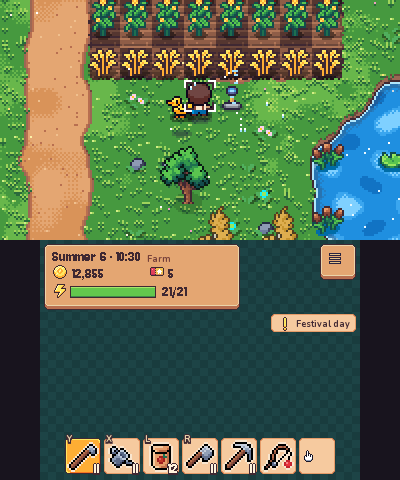
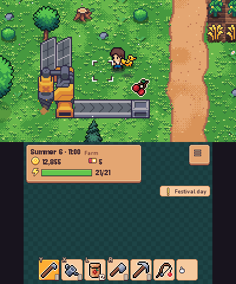

# PocketFarm 3DS

A cozy pocket farm for the **New Nintendo 3DS**: grow crops, raise animals, fish, explore the mine, befriend
the town, collect critters from the capsule machine, and automate it all with conveyor belts, robotic arms and
power.

 

## Install

- **Universal Updater:** search for *PocketFarm*.
- **Manually:** download `PocketFarm.3dsx` from the [latest release](../../releases/latest), copy it to
  `sdmc:/3ds/`, and open it from the Homebrew Launcher.

Saves live in `sdmc:/3ds/PocketFarm/`. For sound, the console needs a DSP dump at `sdmc:/3ds/dspfirm.cdc`
(the game still runs silently without one).

Controls:

| Button | Action |
| --- | --- |
| Circle Pad / D-Pad | walk |
| A | use or interact |
| B | open the menu, or go back |
| Y / X / L / R | tools 1–4 |
| touch screen | HUD, menus, shops |
| START + SELECT | quit |

## Build

The game is a native C99 port of a web game. The art comes from paid asset packs whose licenses forbid
redistribution, so **this repository has the code only**. Building it requires:

- devkitPro: devkitARM, libctru, citro2d, 3dstools.
- node and python3 with Pillow.
- The web project with its `assets/` folder at `../PocketFarmWeb`: [Cute Fantasy](https://kenmi-art.itch.io/cute-fantasy-rpg)
  by Kenmi and the [Automation Asset Pack](https://mwaayk.itch.io) by Mwaayk.

Build commands:

```sh
make CC=arm-none-eabi-gcc   # → PocketFarm.3dsx
make pc                     # headless desktop harness → build/pf (scripted input, screenshots)
node tools/factest.mjs      # factory simulation diffed against the web build
```

`PORT.md` describes the code layout and how the port was tested.

## Credits

- Art:
  - Cute Fantasy by Kenmi.
  - Automation Asset Pack by Mwaayk.
- Fonts: Jersey 10 and Nunito, both SIL Open Font License (see `tools/fonts`).
- Libraries: cJSON, stb_image, and QuickJS-ng (used for the reference "oracle" build only).
